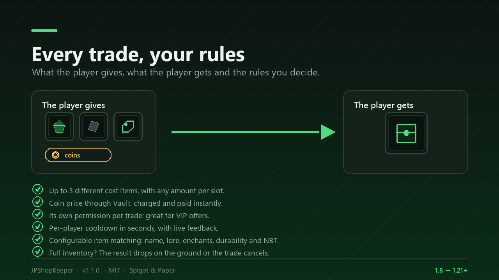
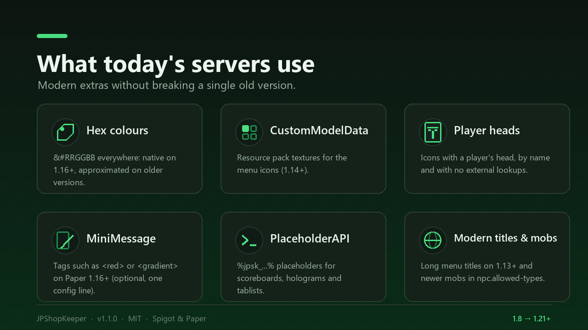

# Features

{ .screenshot }

## NPCs

- Native **mobs** (villager by default, any mob of your version allowed): no
  Citizens, no packets, no NMS.
- **Invulnerable, silent and AI-free** - on 1.8 the flags are written into the
  mob NBT, because that version has neither `setAI` nor `setSilent`.
- **Anchored to their spot**: not even knockback or hitbox pushing moves them
  (they are put back every tick, configurable).
- They **look at the nearest player** and turn back to their default facing.
- The **vanilla villager trade window is always cancelled** for plugin NPCs.
- If an NPC dies or disappears it is **regenerated** automatically, keeping its
  UUID, position and trades.
- If another plugin cancels the spawn (WorldGuard `mob-spawning: deny`, mob
  cleaners...), the console says so with the exact coordinates and retries every
  30 seconds.

## Trades

{ .screenshot }

- Up to **3 cost items** plus a **coin price** through Vault, one result item.
- **Own permission per trade** and **per-player cooldown**.
- **Configurable item matching**: name, lore, enchantments, durability and
  custom NBT.
- **Full NBT support**: tokens, vouchers or items from other plugins are stored
  as they are and only accepted with that exact data.
- **Full inventory**: the result drops on the ground or the trade cancels, your
  choice.
- Amounts are clamped to the real stack size of each material, so a trade can
  never hand out 64 swords.

## Pages and editor

- Up to **45 pages per trader**, 28 trades per page.
- Everything is edited from **chest menus**: name, mob type, pages, trades,
  prices, permissions and cooldowns.
- **Preview as player**, **move the NPC**, and confirmations for every
  destructive action.
- One click on a slot, one click on an item: the editor copies the item (it is
  never consumed).

## Texts, menus and languages

- Every visible text lives in `messages.yml`, every menu in `menus.yml`.
- **Spanish and English included**; adding another language is copying a file.
- Missing keys in a translation fall back to the base file, so an outdated
  translation never shows `<missing:key>` to players.
- Colours: legacy `&`, hex `&#RRGGBB` and optional **MiniMessage**.

## Modern extras

{ .screenshot }

- **Hex colours** `&#RRGGBB` (native on 1.16+, approximated on older versions).
- **MiniMessage** on Paper 1.16+ (`settings.mini-message`).
- **CustomModelData** for menu icons (1.14+) and **player heads** by name.
- **PlaceholderAPI** placeholders `%jpsk_...%`.
- **Cooldowns survive restarts**.
- Long inventory titles on 1.13+ (32 characters only on old clients).

## Data handling

- One readable YAML file per trader.
- **Atomic saves**: a temporary file is written and moved over the real one, so
  a crash cannot leave a half-written trader.
- Trader file names are normalised to lowercase, so a file written by hand with
  uppercase letters cannot freeze your changes.
