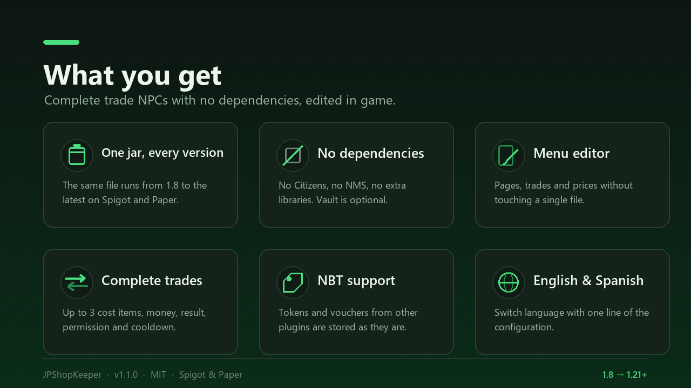

# JPShopKeeper

Trade NPCs with **pages and offers** for Minecraft **1.8 to the latest version**.
One single JAR, no Citizens, no NMS, and everything is configured from an
in-game menu editor.

```
Right click an NPC        ->  the trade menu opens
Shift + right click       ->  the admin panel (edit everything)
```

{ .screenshot }

## Why JPShopKeeper

- **One jar, every version.** Compiled against the Spigot 1.8.8 API with Java 8
  bytecode; materials, sounds and entities are resolved by name at runtime.
- **No dependencies.** No Citizens, no NMS, no libraries. Vault (money) and
  PlaceholderAPI (placeholders) are optional.
- **Edited in game.** Pages, trades, prices, permissions and cooldowns from a
  chest menu. You never have to open a YAML file to set up a shop.
- **Complete trades.** Up to 3 cost items + coin price, result, its own
  permission and a per-player cooldown.
- **NBT support.** Tokens and vouchers from other plugins are stored as they are
  and only accepted with that exact data.
- **Sturdy NPCs.** Invulnerable, no AI, silent, anchored to their spot and
  regenerated automatically if they vanish.
- **English and Spanish included**, plus the modern extras: hex colours,
  MiniMessage, CustomModelData and player heads.

## Quick start

```
1. Drop JPShopKeeper-1.1.0.jar into plugins/ and restart the server.
2. /trader create my_shop        (creates the NPC where you stand)
3. Rename it, pick the mob and open "Pages and trades".
4. Click an empty slot, assign cost and result items, save.
```

Players just right click the NPC.

## Where to go next

- **[Installation](getting-started/installation.md)** - requirements, first
  steps, updating and uninstalling.
- **[Configuration](getting-started/configuration.md)** - every option in
  `config.yml` and `menus.yml`.
- **[Commands and permissions](reference/commands.md)** - the full reference.
- **[Compatibility](compatibility.md)** - what works on which version.

## Support

Questions, bugs and suggestions: the **Discussion** tab of the SpigotMC resource
or the [community Discord](https://discord.gg/VQSvfQw8v8). The source is
unobfuscated and MIT licensed.
